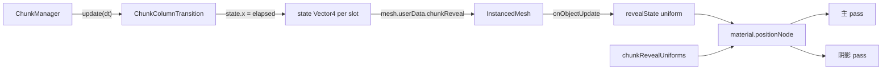

# Chunk 列过渡动效迁移到 GPU（不改 instanceMatrix）

状态：待实施（方案草稿，2026-10-13）

## 目标

把 [`ChunkColumnTransition`](../../../src/world/chunks/ChunkColumnTransition.js) 的列升起动画从"CPU 每帧重写 `instanceMatrix` 并上传"改成"材质 `positionNode` 在顶点着色器里计算位移"。过渡期间 `instanceMatrix` 不再被修改，CPU 每帧只为每个 chunk 写一个 `elapsed`。

## 现状

- `update()` 每帧遍历所有格子更新 `progress`，`applyMesh()` 再遍历 chunk 内所有实例重写 16 个 float，并对整段 `instanceMatrix` 提交上传。开销与实例数成正比。
- 实际只会走 0 到 1 的加载显示路径：`ChunkRenderSlot.populate()` 先调 `resetTransition()`，随后 `startLoading()` 新建 `initiallyVisible=false` 的过渡。因此按格子记录的 `startProgress`、中途反向等逻辑在 GPU 版本中可以删除。
- 进度只取决于时间和格子：

```text
order    = (reverse ? span - c : c) / span      // c = alongX ? cellX : cellZ, span = chunkSize - 1
t        = saturate((elapsed - order * waveDuration) / columnDuration)
progress = smoothstep(t)
footprint = smoothstep(saturate(progress * 4))
x/z      = anchor + (base - anchor) * footprint
y        = base.y * progress - riseDistance * (1 - progress)
```

每个 chunk 只需要 4 个数：`elapsed`、`alongX`、`reverse`、`active`。

与 [2026-10-11-prefab-radial-reveal-design.md](2026-10-11-prefab-radial-reveal-design.md) 的关系：那份文档删除的是 prefab 按距离缩放的径向动画。本方案是 chunk 加载的列过渡，会重新给材质加一个 reveal 用的 `positionNode`，但不引入距离驱动的缩放或淡入。

## 方案



### 1. 位移放在 `positionNode`

`NodeMaterial.setupPosition()` 先执行 `instancedMesh(object)`，再执行 `positionNode`（`node_modules/three/src/materials/nodes/NodeMaterial.js` 约 796-806 行），所以此时 `positionLocal` 已经是 chunk 局部坐标，正好对应现在在矩阵上做的运算。

阴影 pass 在没有 `castShadowPositionNode` 时会复用 `material.positionNode`（`node_modules/three/src/renderers/common/Renderer.js` 约 3413-3419 行），影子自动跟着升起。

### 2. 共享材质下的每 chunk 状态

材质由 `WorldMaterials` 统一持有，所有 slot 共用。用 `uniform().onObjectUpdate()` 按 render object 读取 `object.userData.chunkReveal.state`。uniform 默认属于 `objectGroup`，每个 render object 一份；回调签名为 `callback(frame, self)`（`node_modules/three/src/nodes/core/UniformNode.js` 约 126-140 行）。

`columnDuration`、`waveDuration`、`riseDistance`、`cellSize`、`chunkSize` 作为全局共享 uniform。

取舍：调试面板修改过渡参数会立刻影响正在播放的 chunk，而不是像现在在 `start()` 时各自快照。

### 3. 每个实例的锚点

- terrain、water、lava：实例矩阵是纯平移（[`TerrainBrickRenderer`](../../../src/world/bricks/TerrainBrickRenderer.js) 用 `setPosition`，[`WaterBrickRenderer`](../../../src/world/bricks/WaterBrickRenderer.js) 用 `makeTranslation`，[`LavaBrickRenderer`](../../../src/world/bricks/LavaBrickRenderer.js) 用 `setPosition`），锚点为 `positionLocal.xz - positionGeometry.xz`，不需要额外数据。
- prefab：实例矩阵是 `T * R * child.matrixWorld`，平移分量不等于放置锚点。给每个 bucket mesh 一个包装几何体：共享源几何体的 `index`、attributes、`groups`，额外加 `InstancedBufferAttribute('chunkAnchor', 2)`，写入现在的 `userData.chunkColumnPositions` 数据。

### 4. 包围盒

过渡开始时扩展一次、结束时还原一次，与现在相同。隐藏端的锚点范围直接用整个 chunk 占地（`[0, chunkSize * cellSize]`，y 为 `-riseDistance`），不再逐实例遍历。

### 不采用的方案

- 计算着色器写 `instanceMatrix`：本质仍是改矩阵，且已明确排除。
- 每个 slot 克隆一套材质：材质数量和预热成本变成 9 倍。
- storage buffer 或纹理存每格进度：进度可以解析计算，没必要多存一份，还要处理按对象切换绑定。

## TSL 节点示意

新文件 `src/world/chunks/chunkRevealNode.js`：

```js
import * as THREE from 'three/webgpu'
import { attribute, float, Fn, mix, positionGeometry, positionLocal, select, smoothstep, uniform, vec3 } from 'three/tsl'

export const chunkRevealUniforms = {
  columnDuration: uniform(0.4),
  waveDuration: uniform(0.65),
  riseDistance: uniform(3),
  cellSize: uniform(1),
  chunkSize: uniform(64),
}

// x: elapsed, y: alongX, z: reverse, w: active
const IDLE = new THREE.Vector4(0, 1, 0, 0)
const revealState = uniform(new THREE.Vector4())
  .onObjectUpdate(({ object }) => object.userData.chunkReveal?.state ?? IDLE)

export function chunkRevealPosition({ anchorFromAttribute = false } = {}) {
  return Fn(() => {
    const u = chunkRevealUniforms
    const p = positionLocal
    const anchor = anchorFromAttribute
      ? attribute('chunkAnchor', 'vec2')
      : p.xz.sub(positionGeometry.xz)
    const cell = anchor.div(u.cellSize).floor().clamp(0, u.chunkSize.sub(1))
    const span = u.chunkSize.sub(1).max(1)
    const column = select(revealState.y.greaterThan(0.5), cell.x, cell.y)
    const order = select(revealState.z.greaterThan(0.5), span.sub(column), column).div(span)
    const t = revealState.x.sub(order.mul(u.waveDuration)).div(u.columnDuration.max(1e-4)).saturate()
    const progress = select(revealState.w.greaterThan(0.5), smoothstep(0, 1, t), float(1))
    const footprint = smoothstep(0, 1, progress.mul(4).saturate())
    const xz = mix(cell.add(0.5).mul(u.cellSize), p.xz, footprint)
    return vec3(xz.x, p.y.mul(progress).sub(u.riseDistance.mul(progress.oneMinus())), xz.y)
  })()
}
```

进度为 1 时输出等于原位置，过渡结束后无需任何恢复。

## 实施步骤

1. 新增 `src/world/chunks/chunkRevealNode.js`（上面的节点）。
2. [`src/world/WorldMaterials.js`](../../../src/world/WorldMaterials.js)：给 `legoMaterial`、`waterMaterial`、`lavaMaterial` 设置 `positionNode = chunkRevealPosition()`；`previewMaterial` 可选。不要放进 `createLegoMaterial()`，因为 prefab builder 也调用它，而 prefab 需要 attribute 版本。
3. prefab 材质统一用 `chunkRevealPosition({ anchorFromAttribute: true })`：
   - [`src/world/prefabs/treeMaterial.js`](../../../src/world/prefabs/treeMaterial.js)：`MeshPhysicalMaterial` 换成 `MeshPhysicalNodeMaterial`。
   - [`src/world/prefabs/PrefabRegistry.js`](../../../src/world/prefabs/PrefabRegistry.js)：在 `getVariantAsset()` 返回前，对每个 asset 只处理一次（GLTF 资源和 builder 产物都走这里）。普通 `Mesh*Material` 按 `NodeLibrary.fromMaterial()` 的做法转换（按 type 找到对应 NodeMaterial 类，`for (key in material)` 复制属性），然后设置 `positionNode`；builder 产物已是 NodeMaterial，直接覆盖 `positionNode`。
   - tint 和 instanceColor 材质由 `sourceMaterial.clone()` 生成，`NodeMaterial.copy` 会复制 `positionNode`，无需改动。
4. [`src/world/prefabs/PrefabPlacer.js`](../../../src/world/prefabs/PrefabPlacer.js)：
   - `getOrCreateMeshBucket`：创建包装几何体（共享 `index`、attributes、`groups`、包围体，追加 `chunkAnchor`，长度 `capacity * 2`）。
   - `populateInstancedMesh`：锚点写入 `geometry.attributes.chunkAnchor`，设置 `needsUpdate = true`，删除 `userData.chunkColumnPositions`。
5. [`src/world/prefabs/PrefabPipelineWarmup.js`](../../../src/world/prefabs/PrefabPipelineWarmup.js)：`addWarmupMesh` 使用同样的包装几何体，保证顶点布局与运行时一致。
6. [`src/world/chunks/ChunkColumnTransition.js`](../../../src/world/chunks/ChunkColumnTransition.js)：删除 `progress`、`startProgress`、`delays`、`baseMatrices`、`applyMesh`、矩阵还原。保留：
   - `start(direction, settings)`：计算 `alongX`、`reverse`（沿用现有逻辑），`state.set(0, alongX, reverse, 1)`，写入共享 uniform，`duration = waveDuration + columnDuration`。
   - `capture(group)`：对每个 InstancedMesh 设置 `mesh.userData.chunkReveal = this`，扩展一次包围盒。
   - `update(dt)`：`state.x = elapsed += dt`；`elapsed >= duration` 时还原包围盒、删除 `userData.chunkReveal`，返回 true。
   - `reset()` 和 `discard()`：还原包围盒并删除 `userData.chunkReveal`。
7. [`src/world/chunks/ChunkManager.js`](../../../src/world/chunks/ChunkManager.js)：构造函数里设置一次 `chunkRevealUniforms.cellSize` 和 `chunkSize`。[`ChunkRenderSlot`](../../../src/world/chunks/ChunkRenderSlot.js) 的调用方式（`startLoading`、`updateTransition`、`ensurePrefabsBuilt` 里的补充 capture）基本不变；prefab 晚几帧建好时读的是同一个 `state`，会自动接上当前进度。

## 需要注意的坑

- 预热布局：warmup mesh 必须用带 `chunkAnchor` 的几何体和转换后的材质，否则管线顶点布局不同，首次加载 prefab 时仍会编译卡顿。
- 不要对包装几何体调用 `dispose()`：WebGPU 后端在几何体 dispose 时会释放它引用的所有 attribute 和 index，包括与源几何体共享的部分（`node_modules/three/src/renderers/common/Geometries.js` 约 186-202 行）。bucket 在 slot 生命周期内复用，最终销毁时直接丢弃引用即可。
- 法线不再跟随缩放：方块各面轴对齐，视觉无差别；现在缩放为 0 时法线是退化的。
- 过渡期间 CPU 射线检测拿到的是最终位置，不是动画中的位置。
- `Resources` 里的 prefab GLTF 材质会被就地转换；如果这些资源还在别处使用，需要确认转换不影响那里。

## 边界情况

- `columnDuration = 0`：除以 `max(1e-4)`，立即完成。
- `chunkSize = 1`：`span` 取 1，`order` 为 0。
- `transition.enabled = false`：走 `resetTransition()`，删除 `userData` 后着色器输出原位置。
- `debugSpacing`：只改 `slot.group.position`，不影响 chunk 局部坐标。

## 验证

1. `pnpm dev`，打开 `#debug` 后飞行；通过 `window.__experience` 找到一个 terrain mesh，确认过渡期间 `instanceMatrix.version` 不变。
2. 与当前版本对比波浪方向（X/Z 轴、正向和反向），参数保持一致。
3. 影子是否随列升起；prefab 晚几帧建好后是否与地形同步。
4. 首次加载 prefab 是否出现新的编译卡顿（检查预热覆盖）。
5. 切换 `transition.enabled`、调整 `debugSpacing`，确认没有残留位移。
6. `pnpm test` 通过（当前没有直接覆盖 `ChunkColumnTransition` 的测试）。
